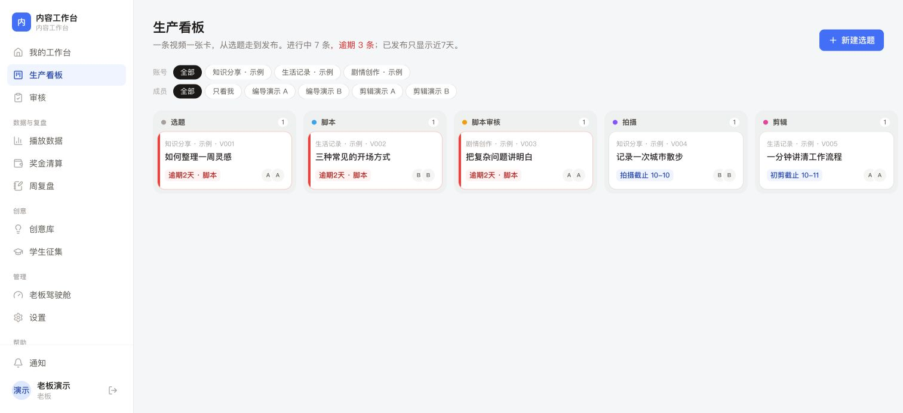
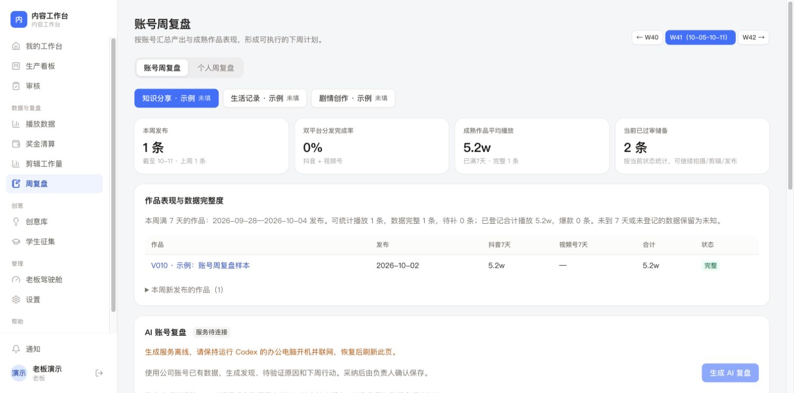
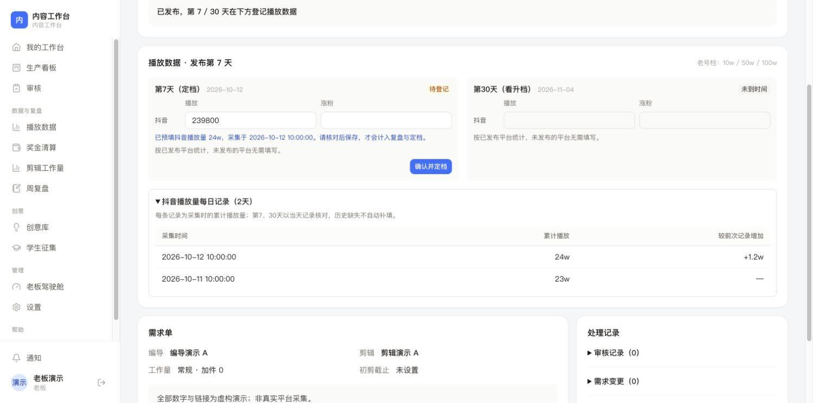

# 内容工作台 · Content Workbench

面向短视频账号运营的协作工作台：选题、脚本、审核、拍摄、剪辑、发布、数据、奖金与周复盘围绕同一条视频流转。

这是实际内部应用的独立开源版本，采用 **MIT 许可证**。人物、账号、视频、指标和奖金规则均为虚构示例；不包含企业凭据、生产数据库、员工资料、内部部署配置或内部 Git 历史。

[个人官网项目介绍](https://nickstudio.cn/content-workbench.html) · [English README](README.en.md) · [许可证](LICENSE)

## 本地体验

需要 **Node.js 22.13+** 和 npm；基础演示无需飞书账号或付费接口。

```sh
git clone https://github.com/lun79345-dotcom/content-workbench.git
cd content-workbench
npm ci
npm run seed:demo
npm run dev
```

打开 <http://127.0.0.1:3000>，选择虚构的老板、编导或剪辑身份。开发服务只监听本机。`seed:demo` 拒绝覆盖已有业务数据；请给现有数据库使用独立 `DATA_DIR`。示例发布链接使用无效的演示域名，所有数字均为虚构，不能用于真实采集或考核。

建议先看生产看板和老板驾驶舱，再看 `/weekly` 的账号周复盘、`/workload` 的剪辑工作量，以及示例视频的第7天预填和每日播放记录。本地身份切换是演示功能，并非真实身份认证。

## 1.1 更新

- **简化表单**：需求单按任务组织，自动带出账号负责人，发布时识别分享链接；保留手动排期。
- **流程与工作量**：八阶段生产流程、审核打回与责任归类、交付工作量、需求变更、操作记录和权限检查。
- **账号周复盘**：按账号查看发布量、成熟作品的第7天效果、数据完整度与爆款表现，保留个人周复盘。
- **可选本机 AI**：通过已登录的 Codex CLI 生成结构化账号复盘草稿，核对、采用并保存后才进入人工复盘。
- **抖音每日播放**：TikHub 专用统计接口每批最多50条，记录每日累计播放；第7／30天只从正确日期的实际快照预填，需核对保存才进入定档与复盘。
- **费用控制**：成功播放每天采集一次；持久化每日总请求和批次上限；每项每天最多尝试两次；手动与自动采集互斥。默认每天100次请求、10个播放批次，可在设置中调整或设0暂停。
- **安全与一致性**：会话过期和退出失效、待审批身份、并发修改检查、操作审计及发布后奖金锁定。

视频号播放量继续手动登记，`read_count` 尚未与创作者后台口径对照。每日累计数据不能回填缺失的历史节点。AI 使用工作台内的账号数据，不含同行对标、完播率或受众画像；分析需要人工核对。公开演示不会调用真实平台服务或自动生成 AI 报告。

## 可选集成

参考 `.env.example`，将自己需要的字段写入 `.env.local`。飞书 OAuth、待审批成员和机器人消息需自行配置企业应用；管理员只按经核对的 `BOSS_FEISHU_OPEN_IDS` 引导，不按显示姓名绑定示例账号或授予权限。TikHub 需要自己的密钥，并产生第三方接口费用。

生产模式必须设置随机 `SESSION_SECRET`，关闭演示登录，使用自己的空数据库；HTTPS 下保持安全 Cookie。示例身份、数字和奖金制度只用于本机体验。源码使用 SQLite，适合单实例部署，尚未验证多租户与分布式部署。

### 本机 Codex AI 复盘

先启动工作台，准备自己已安装并登录的 Codex CLI。配置文件使用绝对路径，不写模型密钥，例如：

```json
{
  "transport": "local",
  "dataDir": "/absolute/path/to/content-workbench/data",
  "codexPath": "/absolute/path/to/codex"
}
```

```sh
npm run build:review-worker
ACCOUNT_REVIEW_CONFIG=/absolute/path/to/worker-config.json npm run review:worker
```

在账号周复盘页点击生成。服务按需处理任务，电脑需开机、联网，CLI 需可用；关闭时人工复盘仍可使用。任务租约、超时和结果验证避免中断结果覆盖新任务。只传账号名、作品标题/类型、发布日期与指标，不传员工身份、奖金、内部需求、发布链接或集成密钥。CLI 在临时目录以只读方式运行，报告采用和人工保存分别操作。

可选 SSH 传输与 Mac 登录启动脚本保留供自行部署，需配置自己的服务器和容器。公开版的启动服务名称为 `org.contentworkbench.account-review`，与内部项目独立。

## 验证与目录

```sh
npm test
npm run lint
npm run build
```

测试使用临时 SQLite 数据库和模拟接口，不调用付费服务或发送真实飞书消息。99项测试覆盖身份权限、流程、数据完整性、奖金锁定、剪辑工作量、账号复盘、AI 队列以及采集预算与重试。公开版不包含真实企业飞书、视频号播放量或生产环境的集成测试结果。

- `src/app`：页面和业务动作。
- `src/lib`：流程规则、SQLite、会话、飞书、采集和复盘队列。
- `scripts`：虚构数据、复盘 worker 与本机服务安装。
- `tests`：业务及集成边界验证。
- `docs`：公开版本的虚构演示界面。






